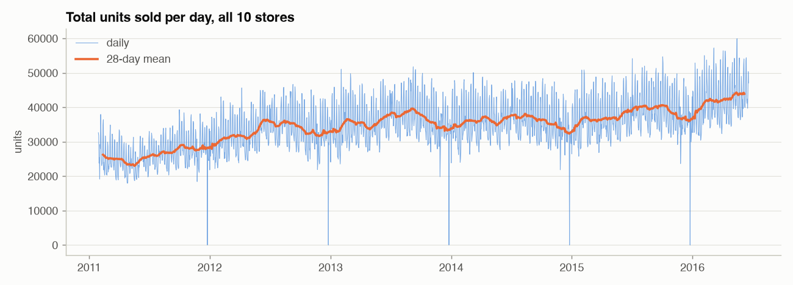
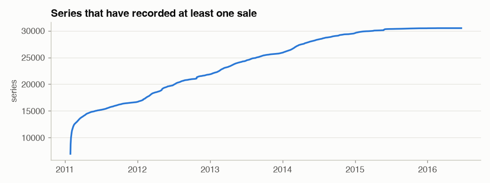
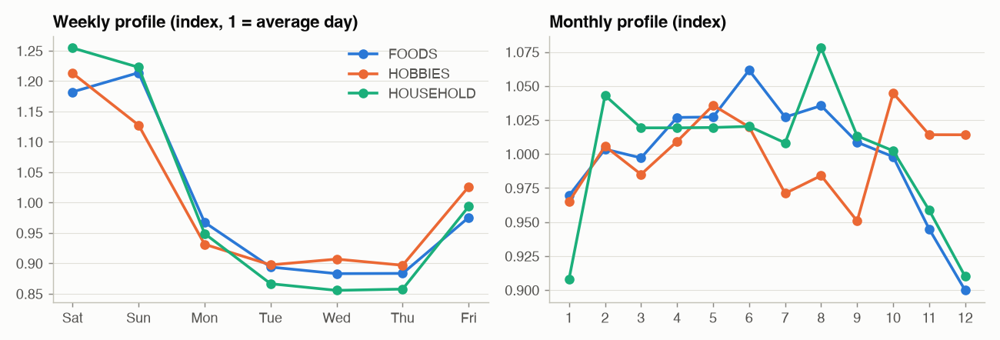
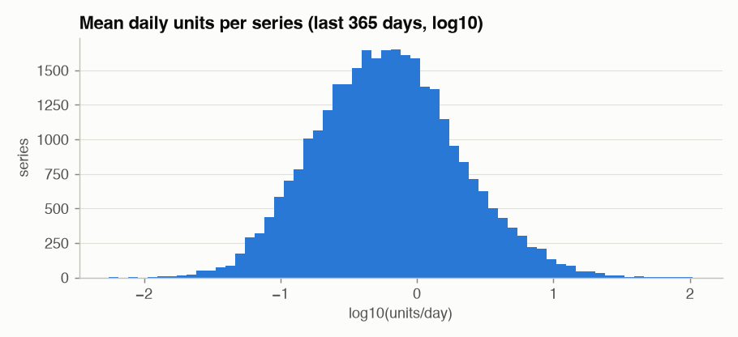

# Phase 1 - Exploratory Data Analysis

## The forecasting object

**30,490 daily series** (3,049 products x 10 stores in California, Texas and Wisconsin), **1,969 days**
(2011-01-29 -> 2016-06-19), 68,156,264 units sold. Each series is one product in one store:
`(date, store_id, item_id) -> units_sold`, plus weekly sell prices, a calendar of 30 events and SNAP
(food-stamp) days per state.

The series form a 12-level hierarchy of **42,840 series** - the business needs forecasts at every level
(item-store for replenishment, store-department for staffing, category-state for purchasing):

|   level | level_name         |   series |
|--------:|:-------------------|---------:|
|       1 | total              |        1 |
|       2 | state              |        3 |
|       3 | store              |       10 |
|       4 | category           |        3 |
|       5 | department         |        7 |
|       6 | state x category   |        9 |
|       7 | state x department |       21 |
|       8 | store x category   |       30 |
|       9 | store x department |       70 |
|      10 | item               |     3049 |
|      11 | item x state       |     9147 |
|      12 | item x store       |    30490 |

* **Trend:** the 28-day mean grows from 26,239 to 43,898
  units/day - partly real growth, partly **new products launching** (see below).
* **Christmas:** sales drop to 20 units on every 25 December - the stores are closed. A model
  that does not know this calls it a "demand collapse"; a data-quality check that does not know it raises a false alarm.
* The dense band is the **weekly cycle**.

## Product launches: the panel is not rectangular

Only 6,979 series sell on day 1; the rest start later (5,028 launch in the
second half of the data). Before its first sale a series is **not on the shelf** - those leading zeros are not
"zero demand" and must not be used for training or for scaling errors. We use the price file to know whether a
product is on the shelf on a given day (no price = not stocked): 79.5% of all cells are on-shelf.

## Seasonality

Weekend days sell 34% more than
Monday-Thursday (2014+). **The weekly cycle is the dominant seasonality** (weekday index range
0.35); the yearly cycle is weaker (monthly index range 0.14; peak
months: FOODS 6, HOBBIES 10, HOUSEHOLD 8; December and January are the low months). That is why
the seasonal-naive forecast with period 7 is the baseline to beat, and why every model gets day-of-week information.

|           |   Sat |   Sun |   Mon |   Tue |   Wed |   Thu |   Fri |
|:----------|------:|------:|------:|------:|------:|------:|------:|
| FOODS     |  1.18 |  1.21 |  0.97 |  0.89 |  0.88 |  0.88 |  0.98 |
| HOBBIES   |  1.21 |  1.13 |  0.93 |  0.90 |  0.91 |  0.90 |  1.03 |
| HOUSEHOLD |  1.25 |  1.22 |  0.95 |  0.87 |  0.86 |  0.86 |  0.99 |

## Intermittent demand

Over the last year, **59% of item-store-days have zero sales**; the median series sells
0.59 units/day. Most retail SKUs are *slow movers*. Syntetos-Boylan classification
(ADI = average gap between sales, CV^2 = variability of non-zero sizes):

| class        |   series |   zero_share |   mean_daily_units |   share_of_units |
|:-------------|---------:|-------------:|-------------------:|-----------------:|
| smooth       |    3,312 |        0.160 |              5.161 |            0.423 |
| erratic      |      739 |        0.176 |              4.870 |            0.089 |
| intermittent |   22,852 |        0.668 |              0.636 |            0.360 |
| lumpy        |    3,587 |        0.558 |              1.438 |            0.128 |

* **Smooth** series behave like textbook time series; ARIMA/ETS are fine there.
* **Intermittent / lumpy** series are mostly zeros. A point forecast of "0.4 units/day" is never observed, yet it is
  the right *expected* demand. Metrics like MAPE are undefined on zero days; Croston-type methods and Tweedie /
  Poisson losses are designed for this.
* Few series carry most volume -> volume-weighted metrics (WAPE, WRMSSE) and per-segment reporting.

## Demand drivers

**SNAP days** (US food-assistance payment days, 10 per month, different per state): average lift in units vs non-SNAP days of the same weekday, 2014+.

| category   |    CA |     TX |     WI |
|:-----------|------:|-------:|-------:|
| FOODS      | +8.9% | +14.5% | +29.5% |
| HOBBIES    | +4.4% |  +2.9% |  +1.9% |
| HOUSEHOLD  | +4.2% |  +3.5% |  +3.8% |

**Events** - total sales on the event day vs the median of the same weekday in the previous 4 weeks (most and least positive):

| event_name_1   |   lift_vs_recent_same_weekday |
|:---------------|------------------------------:|
| Thanksgiving   |                        -28.5% |
| NewYear        |                        -14.8% |
| Mother's day   |                        -12.8% |
| Easter         |                        -11.8% |
| Halloween      |                        -11.1% |
| Cinco De Mayo  |                         +8.2% |
| LentStart      |                         +8.5% |
| NBAFinalsStart |                        +10.6% |
| PresidentsDay  |                        +11.7% |
| LaborDay       |                        +25.6% |

**Prices** change for 26% of series within the last year. Days on which an
item sells >= 10% below its own maximum price (a proxy for a promotion - M5 has no promotion flag):

| category   |   share_of_days_discounted |   units_when_discounted |   units_otherwise |
|:-----------|---------------------------:|------------------------:|------------------:|
| FOODS      |                      0.155 |                   2.061 |             1.769 |
| HOBBIES    |                      0.101 |                   0.549 |             0.670 |
| HOUSEHOLD  |                      0.066 |                   1.303 |             0.855 |

This is correlation, not elasticity: discounted items may also be different items. The model still benefits
from price-relative-to-normal features, which is what Phase 10 builds.

**What this means for the platform**
1. Weekly seasonality + events + SNAP + price are the drivers -> calendar and price are *known-future covariates*.
2. Thousands of sparse, related series -> **global** models that share information beat one model per series.
3. Zeros are the norm -> loss functions (Tweedie) and metrics (WRMSSE, WAPE) that survive zeros.
4. Launches and Christmas closures -> data-quality rules (Phase 2) before anything is trained.
