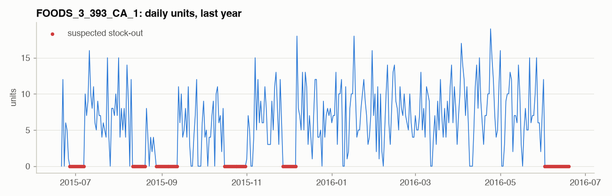

# Phase 2 - Data Quality

## Structural checks on the full history

|                                    |   passed |
|:-----------------------------------|---------:|
| calendar has no gaps               |        1 |
| one row per item x store           |        1 |
| no negative sales                  |        1 |
| no sales without a shelf price     |        1 |
| all prices > 0                     |        1 |
| item belongs to exactly one dept   |        1 |
| store belongs to exactly one state |        1 |

All pass - M5 is a cleaned competition dataset. Real POS feeds fail these regularly (double-loaded files,
returns netted into negative sales, ids re-used). The value of this phase is the **behavioural** checks below,
which find problems no schema check can.

Note: 67% of series have a shelf price *before* their first sale - "launched" (price exists)
and "first sold" are different events.

## Store closures and outages

52 store-days have a total below 10% of the store's usual volume. 50 of them are
Christmas (stores closed - expected). The rest are **unexplained**: a nightly validator must flag them, because a
model trained on them learns a fake demand collapse.

| date       | store_id   |   units |   usual |
|:-----------|:-----------|--------:|--------:|
| 2011-02-02 | WI_1       |       2 |   1,459 |
| 2015-03-24 | TX_2       |     131 |   3,530 |

## Suspected stock-outs (censored demand)

Implausible runs come in two very different kinds:

* **Short runs (< 28 days) = suspected stock-outs: 1.35% of on-shelf days**, affecting 54% of series
  at least once. Demand existed; the shelf was empty. Sales are *censored*.
* **Long runs (28+ days) = item not ranged: 12.24% of on-shelf days**, 72% of
  series. The price file still lists the item but it is not selling at all - delisted, seasonal range, or moved.
  These would dominate the count if we did not separate them.

Neither is "zero demand". Phase 11 tests training with these days removed; Phase 17's inventory simulation
treats stock-outs as lost sales. Labels are saved to `artifacts/data/zero_run_labels.npy`.

| cat       |   stockout_days |   not_ranged_days |   on_shelf_days |   stockout_share |   not_ranged_share |
|:----------|----------------:|------------------:|----------------:|-----------------:|-------------------:|
| FOODS     |         406,247 |         3,076,053 |      22,162,453 |           0.0183 |             0.1388 |
| HOBBIES   |          62,928 |           845,951 |       8,940,126 |           0.0070 |             0.0946 |
| HOUSEHOLD |         174,370 |         1,910,912 |      16,547,361 |           0.0105 |             0.1155 |

## Nightly batch validation: does the gate catch broken files?

| scenario                                 | verdict   | checks fired                                             |
|:-----------------------------------------|:----------|:---------------------------------------------------------|
| clean file                               | WARN      | unit_spike(1)                                            |
| 500 rows loaded twice                    | BLOCK     | duplicates(1000), unit_spike(1)                          |
| returns netted as negative units         | BLOCK     | negative_units(40), unit_spike(1)                        |
| store TX_2 missing                       | BLOCK     | missing_series(3049), unit_spike(1), store_total_drop(1) |
| WI_1 partial upload (30% of rows' units) | BLOCK     | unit_spike(1), store_total_drop(1)                       |
| 5 fat-finger quantities (900 units)      | WARN      | unit_spike(6)                                            |
| 30 prices in cents instead of dollars    | WARN      | unit_spike(1), price_jump(30)                            |
| yesterday's file re-sent                 | BLOCK     | date(30490), unit_spike(1)                               |
| 3 unknown new items                      | WARN      | unknown_series(3), unit_spike(1)                         |

The clean file is not silent: `unit_spike` - units far above the series' history, e.g. FOODS_3_522/CA_3=13. Real data contains genuine outliers; that is why spikes are warnings, not blockers.

`BLOCK` stops the nightly run: yesterday's forecast stays live and the data team is paged - a stale forecast
is better than a forecast built on a broken file. `WARN` lets the run proceed and records the issue for monitoring.
The same `check_batch` function runs inside the nightly job (`serving/nightly.py`).
