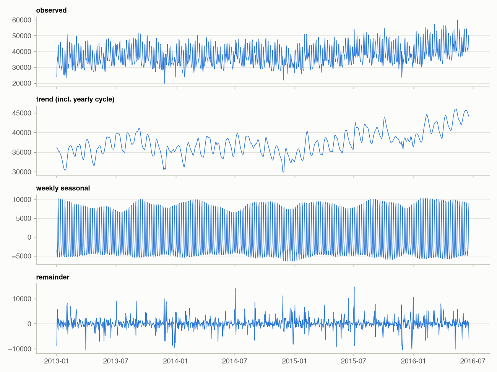
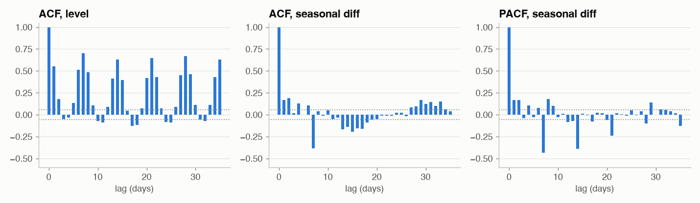

# Phase 3 - Decomposition and Stationarity

## STL decomposition of total sales

`y_t = T_t + S_t + R_t` (STL, robust, weekly period; Christmas closures interpolated first).

Variance shares of the total series 2013+: trend+yearly **23%**, weekly
**73%**, remainder **13%** (shares need not sum to 1 - components covary).
The "trend" is not smooth: it wiggles with a period of about a month - the **SNAP cycle** (food-stamp days fall in
the first half of each month, Phase 1). A weekly-period STL cannot separate it; a model needs a SNAP covariate.
A second STL on the trend with period 365 separates the yearly cycle (amplitude
10,649 units/day vs weekly amplitude 16,863).

## Is it stationary? ADF and KPSS, before and after differencing

|                                                             |   ADF p (H0: unit root) |   KPSS p (H0: stationary) | verdict        |
|:------------------------------------------------------------|------------------------:|--------------------------:|:---------------|
| ('total', 'level')                                          |                   0.105 |                     0.010 | non-stationary |
| ('total', 'first difference')                               |                   0.000 |                     0.100 | stationary     |
| ('total', 'seasonal difference (7)')                        |                   0.000 |                     0.100 | stationary     |
| ('total', 'log, seasonal difference')                       |                   0.000 |                     0.100 | stationary     |
| ('store CA_3', 'level')                                     |                   0.004 |                     0.100 | stationary     |
| ('store CA_3', 'first difference')                          |                   0.000 |                     0.100 | stationary     |
| ('store CA_3', 'seasonal difference (7)')                   |                   0.000 |                     0.100 | stationary     |
| ('store CA_3', 'log, seasonal difference')                  |                   0.000 |                     0.100 | stationary     |
| ('store x dept TX_2/FOODS_3', 'level')                      |                   0.121 |                     0.010 | non-stationary |
| ('store x dept TX_2/FOODS_3', 'first difference')           |                   0.000 |                     0.100 | stationary     |
| ('store x dept TX_2/FOODS_3', 'seasonal difference (7)')    |                   0.000 |                     0.100 | stationary     |
| ('store x dept TX_2/FOODS_3', 'log, seasonal difference')   |                   0.000 |                     0.100 | stationary     |
| ('store x dept WI_1/HOBBIES_2', 'level')                    |                   0.010 |                     0.010 | inconclusive   |
| ('store x dept WI_1/HOBBIES_2', 'first difference')         |                   0.000 |                     0.100 | stationary     |
| ('store x dept WI_1/HOBBIES_2', 'seasonal difference (7)')  |                   0.000 |                     0.100 | stationary     |
| ('store x dept WI_1/HOBBIES_2', 'log, seasonal difference') |                   0.000 |                     0.100 | stationary     |

ADF's null is "unit root" (non-stationary); KPSS's null is "stationary". They agree only when the evidence is
clear. Levels of growing aggregates are non-stationary (trend); a seasonal difference removes most of it. This is
what the `d` and `D` in SARIMA(p,d,q)(P,D,Q)_7 do, and why AutoARIMA runs these tests to choose them (Phase 7).

Stationarity is a modelling assumption of ARIMA, **not** a requirement of forecasting in general: tree models and
neural nets instead need the *relationship between features and target* to be stable, which is why they get
level-free features (ratios, recent means) and why Phase 22 studies drift.

## Autocorrelation: what does the past say about tomorrow?

TX_2 / FOODS_3 (store x department). On levels the ACF decays slowly with spikes at 7, 14, 21, 28
(lag-7 autocorrelation 0.70, lag-1 0.55) - the signature of trend + weekly seasonality.
After seasonal differencing the ACF spikes negative at lag 7 (-0.39) and the PACF
decays at lags 7, 14, 21 - the textbook signature of a **seasonal MA(1)** term, with small positive AR at lags 1-2.
That is the SARIMA(p,0,q)(0,1,1)_7 shape Phase 7's AutoARIMA usually lands on.

**Why this matters for features**: lags 7, 14, 21, 28 carry the weekly signal. A model that must forecast 28
days ahead cannot use lag 1 for day 28 - Phase 10 builds lags that respect the forecast horizon.

## Item level: the textbook picture breaks

300 random item-store series (last year): 55% test stationary,
11% non-stationary, 34% inconclusive. Median lag-7
autocorrelation is only **0.08** (total series: 0.78): at item level
the weekly pattern is buried in Poisson-like noise. Aggregates are smooth and predictable; items are noisy - one
reason forecasts are reconciled across the hierarchy (Phase 16) and models are trained globally (Phase 11).
