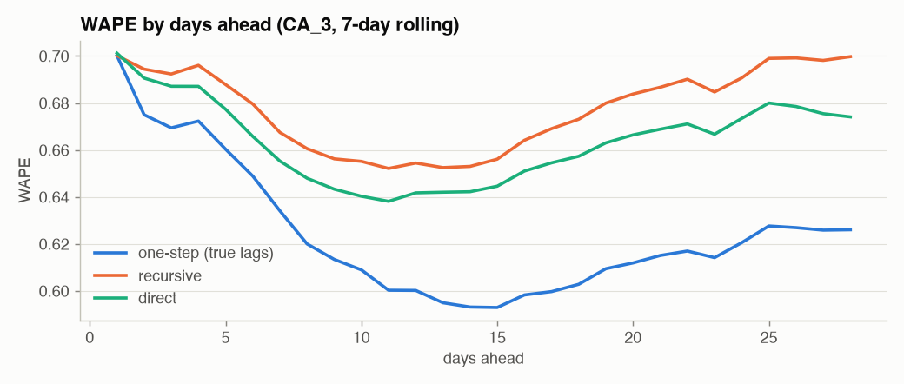
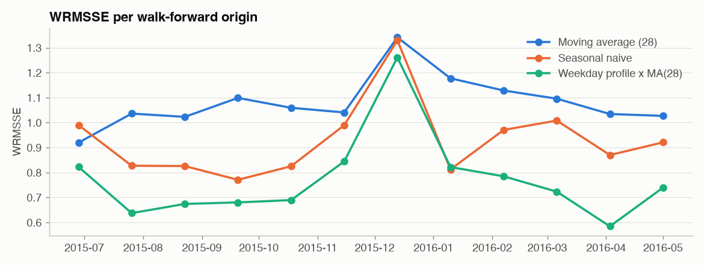

# Phase 4 - Validation Design and Leakage

**Question: if we randomly shuffle the rows before training a forecasting model, why is that a problem?**

Because a forecast is always made *at a point in time* about *later* days. A random split puts days from the future
in the training set and days from the past in the test set, so:
1. the model is trained on information it will never have when it forecasts (tomorrow's sales, next month's level);
2. with lag features, a test row's target literally appears as a *feature* of the neighbouring training rows
   (`lag_1` of Tuesday = Monday's sales), so the model can interpolate instead of forecast;
3. the score measures interpolation inside the known period, not extrapolation into the unknown one - so it is
   optimistic, and it ranks models wrongly (complex models interpolate best).

Below, the same LightGBM on store CA_3 (3,049 items, trained 2015-01-01 onwards) is evaluated five ways.

## Five evaluations of the same model

|                                                                     | WAPE   | vs honest direct   |
|:--------------------------------------------------------------------|:-------|:-------------------|
| 1. random 80/20 split, lag-1 features                               | 59.6%  | -8.9%              |
| 2. time split, lag-1 features, one-step-ahead (true lags every day) | 61.0%  | -6.7%              |
| 3. time split + leaky centred moving average                        | 50.1%  | -23.4%             |
| 4. time split, recursive 28-day forecast (honest)                   | 67.0%  | +2.5%              |
| 5. time split, direct 28-day forecast (honest)                      | 65.4%  | +0.0%              |

Test window 2016-03-28 .. 2016-04-24. WAPE = sum|error| / sum(actual).

* **(1) Random split** looks 9% better than reality. It is the number a notebook produces when
  `train_test_split(shuffle=True)` is applied to a sales table.
* **(2) One-step-ahead** evaluation is honest about time but not about the *use*: the planner needs day 28 today,
  when days 1-27 are still unknown. Reporting one-step accuracy for a 28-day plan is a common, subtle leak.
* **(3) A centred moving average** uses days t+1..t+3 - a feature that does not exist at forecast time. A
  backtest built on the full table happily computes it; production cannot.
* **(4) and (5)** are what the business will experience. Their gap to (1) is the size of the illusion.

## Error grows with the horizon



Week 1 vs week 4 WAPE: recursive 66.7% -> 70.0%,
direct 65.5% -> 67.4%. Accuracy must always be reported
**per horizon** - "the model is 25% WAPE" means nothing without "at how many days ahead".

## One backtest window is not enough: walk-forward

| origin     |   Moving average (28) |   Seasonal naive |   Weekday profile x MA(28) |
|:-----------|----------------------:|-----------------:|---------------------------:|
| 2015-06-28 |                 0.920 |            0.990 |                      0.823 |
| 2015-07-26 |                 1.036 |            0.827 |                      0.637 |
| 2015-08-23 |                 1.023 |            0.826 |                      0.674 |
| 2015-09-20 |                 1.099 |            0.771 |                      0.680 |
| 2015-10-18 |                 1.059 |            0.825 |                      0.690 |
| 2015-11-15 |                 1.041 |            0.990 |                      0.844 |
| 2015-12-13 |                 1.341 |            1.330 |                      1.261 |
| 2016-01-10 |                 1.177 |            0.812 |                      0.822 |
| 2016-02-07 |                 1.129 |            0.971 |                      0.785 |
| 2016-03-06 |                 1.096 |            1.008 |                      0.723 |
| 2016-04-03 |                 1.034 |            0.870 |                      0.585 |
| 2016-05-01 |                 1.027 |            0.921 |                      0.740 |

Walk-forward (expanding window): train on everything up to the origin, forecast 28 days, move the origin by
28 days, repeat.

* The **same model** scores between 0.585 and 1.261 depending on the window - the window
  matters as much as the model. The worst window for every model starts 2015-12-13 (Christmas closures fall inside it).
* The weekday-profile model beats seasonal naive in 11 of 12 windows. Had we picked a single
  window we might have chosen the wrong model (1 window(s) say the opposite), and for close
  pairs (Phase 14) one window is a coin flip.

Model selection therefore uses **3 walk-forward origins** (Phase 14) and reports the spread; the final **holdout**
(M5's evaluation window) is touched once.

```
fold 1   train ███████████████████████░░░░ test
fold 2   train ███████████████████████████░░░░ test
fold 3   train ███████████████████████████████░░░░ test
holdout  train ███████████████████████████████████████░░░░ (once, at the end)
```


