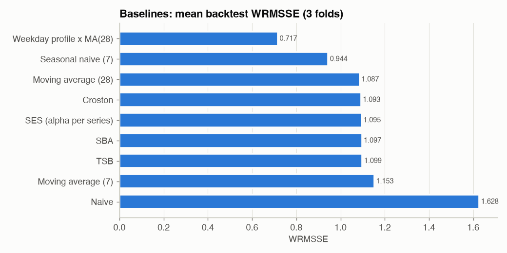

# Phase 5 - Baselines and Metrics

Evaluation windows used from here on (all 30,490 series):

| origin               | train_end   | test_start   | test_end   |
|:---------------------|:------------|:-------------|:-----------|
| fold1 (2016-01-31)   | 2016-01-31  | 2016-02-01   | 2016-02-28 |
| fold2 (2016-02-28)   | 2016-02-28  | 2016-02-29   | 2016-03-27 |
| fold3 (2016-03-27)   | 2016-03-27  | 2016-03-28   | 2016-04-24 |
| holdout (2016-05-22) | 2016-05-22  | 2016-05-23   | 2016-06-19 |

## The baseline ladder (WRMSSE, lower is better)

| model                    |   fold1 (2016-01-31) |   fold2 (2016-02-28) |   fold3 (2016-03-27) |   backtest mean |   holdout (2016-05-22) |
|:-------------------------|---------------------:|---------------------:|---------------------:|----------------:|-----------------------:|
| Naive                    |                1.702 |                1.696 |                1.486 |           1.628 |                  1.752 |
| Moving average (7)       |                1.176 |                1.121 |                1.163 |           1.153 |                  0.955 |
| TSB                      |                1.134 |                1.056 |                1.107 |           1.099 |                  0.942 |
| SBA                      |                1.121 |                1.050 |                1.120 |           1.097 |                  0.958 |
| SES (alpha per series)   |                1.082 |                1.059 |                1.145 |           1.095 |                  0.956 |
| Croston                  |                1.072 |                1.077 |                1.131 |           1.093 |                  0.956 |
| Moving average (28)      |                1.112 |                1.050 |                1.097 |           1.087 |                  0.946 |
| Seasonal naive (7)       |                1.021 |                0.889 |                0.923 |           0.944 |                  0.847 |
| Weekday profile x MA(28) |                0.808 |                0.691 |                0.651 |           0.717 |                  0.713 |

Our seasonal naive and naive reproduce the official M5 benchmarks on the holdout exactly
(**0.847** and **1.752**; published: 0.847
and 1.752), which validates the WRMSSE implementation.

* **Naive** (tomorrow = today) is terrible here: it copies one random day of a weekly cycle for 28 days.
* **Seasonal naive** copies last week - simple and strong because weekly seasonality dominates (Phase 3).
* Flat forecasts (moving averages, SES, Croston family) lose the weekly shape; at item level they are fine,
  at aggregate levels the missing weekday pattern costs a lot (see by-level table).
* **Weekday profile x MA(28)** - a level from the last 28 days times a weekday shape from the last 26 weeks - is the best
  baseline. Every model from here on has to beat **0.717** backtest WRMSSE to earn its
  complexity.

## Where the error comes from (holdout, WRMSSE per hierarchy level)

|                    |   Seasonal naive (7) |   TSB |   Weekday profile x MA(28) |
|:-------------------|---------------------:|------:|---------------------------:|
| total              |                0.560 | 0.884 |                      0.487 |
| state              |                0.673 | 0.901 |                      0.568 |
| store              |                0.718 | 0.909 |                      0.622 |
| category           |                0.623 | 0.894 |                      0.531 |
| department         |                0.708 | 0.957 |                      0.627 |
| state x category   |                0.760 | 0.930 |                      0.631 |
| state x department |                0.829 | 0.977 |                      0.710 |
| store x category   |                0.801 | 0.928 |                      0.683 |
| store x department |                0.888 | 0.971 |                      0.764 |
| item               |                1.223 | 1.057 |                      1.027 |
| item x state       |                1.205 | 0.985 |                      0.980 |
| item x store       |                1.176 | 0.916 |                      0.927 |

Item-level series (levels 10-12) are noisy and score ~1 for everything - roughly as good as a naive
forecast's in-sample error. Aggregates (levels 1-9) separate the models: the weekly shape matters there.
WRMSSE weights the 12 levels equally, so a forecast must be good **both** for an item on a shelf and for a store's
total - the business needs both.

## What does each metric reward?

|                                                 |   mae |   rmse |   wape |   bias |   mape |   smape |   mase |   rmsse |   WRMSSE |
|:------------------------------------------------|------:|-------:|-------:|-------:|-------:|--------:|-------:|--------:|---------:|
| Seasonal naive (7)                              | 1.319 |  2.931 |  0.916 | -0.012 |  0.835 |   0.860 |  1.261 |   1.035 |    0.847 |
| Moving average (28)                             | 1.120 |  2.447 |  0.778 |  0.002 |  0.590 |   1.371 |  1.106 |   0.780 |    0.946 |
| Weekday profile x MA(28)                        | 1.117 |  2.422 |  0.776 |  0.002 |  0.602 |   1.380 |  1.107 |   0.789 |    0.713 |
| Always zero                                     | 1.440 |  4.124 |  1.000 | -1.000 |  1.000 |   0.895 |  1.058 |   0.969 |    5.391 |
| Weekday profile x MA(28) x 0.7 (under-forecast) | 1.092 |  2.590 |  0.758 | -0.299 |  0.600 |   1.445 |  1.035 |   0.788 |    1.788 |

Holdout, all 30,490 item-store series (55% of actual cells are zero; MAPE ignores those cells).

* **The 30% under-forecast wins on MAE, WAPE and MASE** (1.092 / 0.758 /
  1.035 vs 1.117 / 0.776 / 1.107 for the
  unbiased forecast). Absolute-error metrics are minimised by the *median*, and for intermittent demand the median
  sits below the mean - they quietly reward under-forecasting, i.e. empty shelves.
* **"Always zero"** - a forecast that stocks nothing - beats seasonal naive on MASE (1.058 vs
  1.261) and RMSSE, and beats the moving average on sMAPE.
* **MAPE** cannot separate the unbiased and the under-forecast (0.602 vs 0.600), and
  it silently dropped 55% of cells. Never use MAPE on SKU-level retail data.
* **Bias** exposes the under-forecast immediately (-30%), and **WRMSSE** punishes it hard
  (1.788 vs 0.713) because aggregation turns a consistent bias into large
  errors at store and total level. Every report from here on shows bias next to accuracy.
* **RMSE / RMSSE / WRMSSE** are minimised by the *mean*, the quantity inventory planning needs for expected demand;
  that is why M5 (and this project) select models on WRMSSE, and report WAPE + bias for the business.

Worked example from the brief (actual 100, forecast 90): error 10, MAE 10, MSE 100, RMSE 10, MAPE 10%. With actual
0 and forecast 1, MAPE is undefined (division by zero) while MAE is 1 - the whole story of this table.

