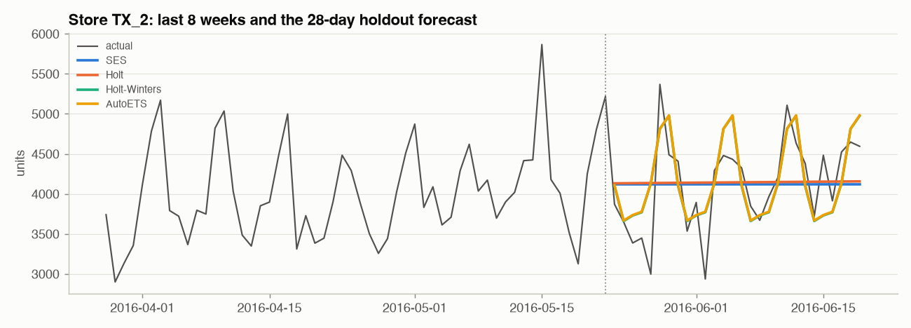

# Phase 6 - Exponential Smoothing

## Item level: 500 sampled item-store series

Each model is fitted separately on every series, using the last
365 days before each origin (Christmas closures interpolated). RMSSE = per-series
RMSE scaled by that series' naive in-sample error, averaged; WAPE and bias are volume-weighted.

| model                    |   RMSSE (backtest) |   RMSSE (holdout) |   WAPE (backtest) |   bias (backtest) |
|:-------------------------|-------------------:|------------------:|------------------:|------------------:|
| AutoETS                  |              0.740 |             0.777 |             0.737 |            -0.014 |
| SES                      |              0.744 |             0.780 |             0.749 |             0.005 |
| Weekday profile x MA(28) |              0.744 |             0.789 |             0.732 |            -0.025 |
| Holt-Winters             |              0.746 |             0.785 |             0.743 |            -0.013 |
| Holt                     |              0.748 |             0.785 |             0.754 |             0.008 |
| Seasonal naive (7)       |              0.963 |             1.029 |             0.864 |            -0.055 |

## Aggregate levels (forecast directly at that level)

**store x dept** (70 series)

| model                                 |   RMSSE (backtest) |   RMSSE (holdout) |   WAPE (backtest) |   bias (backtest) |
|:--------------------------------------|-------------------:|------------------:|------------------:|------------------:|
| Weekday profile x MA(28)              |              0.822 |             0.832 |             0.116 |            -0.026 |
| Weekday profile, bottom-up from items |              0.824 |             0.833 |             0.117 |            -0.026 |
| AutoETS                               |              0.891 |             0.814 |             0.127 |            -0.035 |
| Holt-Winters                          |              0.907 |             0.819 |             0.132 |            -0.038 |
| Seasonal naive (7)                    |              1.071 |             1.001 |             0.155 |            -0.061 |
| Holt                                  |              1.165 |             1.003 |             0.191 |            -0.005 |
| SES                                   |              1.269 |             1.092 |             0.231 |             0.074 |

**store** (10 series)

| model                                 |   RMSSE (backtest) |   RMSSE (holdout) |   WAPE (backtest) |   bias (backtest) |
|:--------------------------------------|-------------------:|------------------:|------------------:|------------------:|
| Weekday profile x MA(28)              |              0.645 |             0.611 |             0.082 |            -0.026 |
| Weekday profile, bottom-up from items |              0.652 |             0.618 |             0.083 |            -0.026 |
| AutoETS                               |              0.681 |             0.602 |             0.085 |            -0.035 |
| Holt-Winters                          |              0.697 |             0.594 |             0.087 |            -0.039 |
| Seasonal naive (7)                    |              0.867 |             0.717 |             0.110 |            -0.061 |
| Holt                                  |              1.121 |             0.892 |             0.151 |            -0.035 |
| SES                                   |              1.417 |             1.321 |             0.210 |             0.091 |

**total** (1 series)

| model                                 |   RMSSE (backtest) |   RMSSE (holdout) |   WAPE (backtest) |   bias (backtest) |
|:--------------------------------------|-------------------:|------------------:|------------------:|------------------:|
| AutoETS                               |              0.512 |             0.528 |             0.058 |            -0.024 |
| Holt-Winters                          |              0.528 |             0.442 |             0.058 |            -0.018 |
| Weekday profile x MA(28)              |              0.545 |             0.477 |             0.060 |            -0.026 |
| Weekday profile, bottom-up from items |              0.554 |             0.487 |             0.061 |            -0.026 |
| Seasonal naive (7)                    |              0.752 |             0.560 |             0.087 |            -0.061 |
| Holt                                  |              1.180 |             0.856 |             0.131 |            -0.039 |
| SES                                   |              1.703 |             1.962 |             0.212 |             0.173 |

*Weekday profile, bottom-up from items* = the item-level baseline forecasts summed up the hierarchy - the
cheapest way to get coherent aggregate forecasts (Phase 16 compares this with proper reconciliation).

**Reading the results**

* **No seasonal component, no chance at aggregate level.** SES and Holt forecast a flat line / straight line; at
  store x dept their backtest RMSSE is 1.269 / 1.165
  vs 0.907 for Holt-Winters. The weekly cycle is most of the signal (Phase 3).
* **Item level is a dead heat**: every model lands at RMSSE 0.740 -
  0.748. At 0-3 units a day, noise dominates and the seasonal
  component barely matters; seasonal naive is the outlier (0.963)
  because copying one noisy week amplifies noise.
* **AutoETS vs the weekday-profile baseline flips with the window**: backtest store x dept AutoETS 0.891 vs baseline 0.822,
  store AutoETS 0.681 vs baseline 0.645, total AutoETS 0.512 vs baseline 0.545; on the holdout store x dept
  AutoETS 0.814 vs baseline 0.832. A textbook model is not automatically better than a well-built heuristic - and
  single-window comparisons would have told either story (Phase 4).
* All models are slightly **negatively biased** (under-forecast) in the backtest windows: sales were growing.

ETS = weighted averages of the past with exponentially decaying weights, extended with level, trend and season
states (AutoETS picks additive/multiplicative/none forms by AICc). Fast, robust, and still the default in many
supply-chain tools.
